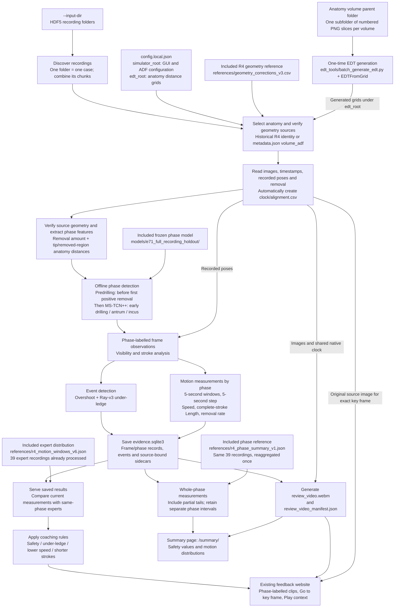

# Mastoid Feedback System

Process a completed HDF5 recording folder into video, phase detection, events
and feedback. One subfolder is one recording; its HDF5 files are chunks of that
recording. The existing website is used without per-recording configuration.

## Install

Use Python 3.12 on Windows or Linux (x86-64). From the project root:

```text
pip install -r requirements.txt
```

All processing, including phase inference, uses the same Python environment.
The requirements include CPU PyTorch; CUDA is not required. Local environments
such as `.venv/` are ignored by Git and are not part of the repository.

Before pushing code changes, also install the development tools and run both
GitHub checks (on Windows, macOS or Linux):

```text
python -m pip install --editable ".[pipeline,vision,dev]"
python -m ruff check src tests
python -m pytest -q
```

These checks use generated fixtures; the full HDF5 runtime installation above
also includes PyTorch for phase inference.

## Configure once

The only file you edit for machine paths is **`config.local.json` in this project
root**. Copy `config.example.json` if it does not exist.

| Setting | Value |
| --- | --- |
| `simulator_root` | Anatomy resource root containing `scripts/study_gui/gui_setup.yaml` and its matching `ADF/` files. Supplies specimen identity, orientation, dimensions and units; no running simulator is needed. |
| `edt_root` | Parent directory of the `edt_grids_<specimen>_256/` folders; may differ from `simulator_root` |
| `correction_table` | Included: `references/geometry_corrections_v3.csv`. Keep this relative path and the original CSV bytes. |
| `phase_model_bundle` | Included: `models/e71_full_recording_holdout/` (0.92 MB total). Keep this relative path; the frozen offline MS-TCN++ is ready for inference. |
| `video_fps` | Output video frame rate, default 10; does not change native timestamps or signal sampling |
| `motion_reference` | Saved expert distribution: `references/r4_motion_windows_v6.json`, included with the project. Keep this relative path when migrating; `null` disables expert motion comparisons. |
| `phase_summary_reference` | Included whole-phase distribution: `references/r4_phase_summary_v1.json` (0.43 MB). Keep this relative path when migrating; `null` disables the Summary page's expert comparisons. |

For a new batch, change `--input-dir`; alignment and per-recording configuration
are generated automatically. New recordings with `volume_adf` in `metadata.json`
select their anatomy model and EDT automatically. If an unknown recording lacks
this information, supply its actual specimen with `--anatomy-model RT138`, for example.
See [input format changes](docs/hdf5-directory-input.md#simulator-format-changes)
for supported fields and the shared reader to update if the simulator format changes.

Only `simulator_root` and `edt_root` normally need changing when moving machines.
The HDF5 input location is supplied separately with `--input-dir`.
Relative paths are resolved from this project root. EDTs can be stored separately
from the anatomy configuration. Model/grid identity, geometry and content hashes
remain checked after moving them. The correction CSV is copied unchanged; do not
edit or re-save it. No manual phase labels or original video are required.

No Python executable path is needed in the configuration.

The model bundle, correction CSV and saved expert reference are included with the
project in Git-visible `models/` and `references/` directories. The model bundle
contains `model.pt` (weights), `neural_preprocessing.json` (frozen input transforms)
and `manifest.json` (feature definitions and integrity hashes). No separate model
download or training is needed. Anatomy/EDT resources and `config.local.json`
remain machine-specific. Rebuild results on the new machine; old results contain
absolute source paths and remain archives.

The correction CSV is the fixed R4 geometry reference, not a phase model or a
per-recording form to fill in. It records historical specimen identities,
rotations, unit scales and review status. The current pipeline also uses it to
check supported anatomy parameters for new recordings. New recordings use their
selected model's current ADF rotation; another recording's fitted rotation is
never transferred. Keep the included CSV unchanged: its exact hash is checked.
Git attributes preserve the frozen resources' bytes on Windows and Linux.

## Generate anatomy EDT grids

You can also use pre processed EDT grid on: https://livejohnshopkins-my.sharepoint.com/:f:/r/personal/xzou8_jh_edu/Documents/skill_assessment_data/SDF_based_assistance?d=w93bcda23ec904a46a09a468be4439114&csf=1&web=1&e=f2hU25. Please download all the EDT folders.

The anatomy models' EDT grids can be generated with the included
[`edt_tools/batch_generate_edt.py`](edt_tools/batch_generate_edt.py) script.
Its input is the **folder containing the anatomy volumes**: each immediate
subfolder contains one volume's numbered, anatomy-color PNG slices.

```text
python edt_tools/batch_generate_edt.py --volumes "./volumes" --output "./data/edt" --exe "/path/to/EDTFromGrid"
```

- `--volumes`: the parent folder containing all volume subfolders.
- `--output`: the parent folder for generated EDTs; set `edt_root` to this location.
- `--exe`: an existing compiled `EDTFromGrid` executable for your operating system
  (`EDTFromGrid.exe` on Windows). It is separate from the Python dependencies.

The script generates 16 anatomy `.edt` files per volume and preserves each input
subfolder's name: `<output>/<volume-subfolder>/`. For use in this pipeline, the
generated folder names must match `gui_setup.yaml`'s `sdf_path`, for example
`edt_grids_LT151_256`. The script does not add that prefix or rename folders.
Keep input and output folders separate and non-nested. Existing `.edt` files are
skipped, so use a new output folder when regenerating grids.

This is a one-time resource preparation step, separate from processing recordings.
The HDF5 pipeline still checks the generated grids' identity, geometry and hashes
against the fixed R4 EDT catalog.

## Run

From the project root on Windows or Linux, replace the input directory:

```text
python run.py process-hdf5 --input-dir ./recordings --serve
```

The default `--anatomy-model auto` selects known R4 identities from the trusted
correction table, or new recordings from `metadata.json`'s `volume_adf` basename.
If neither identifies a specimen, provide `--anatomy-model LT151` (for example).
An explicit model conflicting with recorded metadata is rejected. The phase network
always remains the installed frozen offline MS-TCN++ model.

The command creates a new folder under `results/hdf5_batches/`, generates IDs,
alignment, configuration, video and feedback, then prints the website address
(default local port 8810 onward). Existing inputs/results are not overwritten.
`--prepare-only` validates inputs without inference/video. `--base-port` chooses another
starting port if one is occupied.

To reopen completed feedback without rebuilding:

```text
python run.py serve-batch --manifest <batch-directory>/recommendations_manifest.json
```

Select **Summary** on the feedback page, or append `/summary/` to the same server
address. Both views use the same recording and video; no new processing command
is needed. Restart an already running server after updating the application.

In the existing **Study ID** entry (`expert-study` mode), **Show first** selects
**Event-based** or **Summary**. After automatic analysis, **Next** follows this
fixed order for the same ID and recording:

**First view → Questionnaire placeholder → Second view → Questionnaire placeholder → Complete.**

There are no free-switching tabs during the study. Each questionnaire is a blank
placeholder awaiting design; it collects no answers. The initial order and current
step are saved per Study ID/case and restored after refresh. Advancing pauses
hidden playback. Only continuing past the second questionnaire completes the case;
the next configured case, if any, follows afterward. The selected order is carried
to that case and is not a randomized assignment.

The Event-based step uses the same video-left, feedback-right layout and key-frame
controls as the standalone feedback page. It has no additional coaching-moment
entry form or audio recording controls. The two columns stack on narrow screens.

Coaching cards expand in place, one at a time. **Safety & visibility** contains
Drill visibility (orange) and Critical Structure Violation (red), followed by
**Motion**: Low tool movement speed (blue) and Short drill strokes (dark blue).
Colors identify topics, not priority levels. Cards show the observation and action;
priority badges and the separate "Why it matters" section are not displayed.
These presentation labels do not change event qualification or establish injury.

The compact procedure map contains one marker per review moment. Selecting a
marker opens its coaching card and corresponding moment. A verified native frame
opens as a key frame; otherwise the video pauses at the interval start without
claiming an exact source frame. All moments remain available in a separate
scrolling list showing about three single-line rows; moving through this list does
not scroll the player. Number, phase, time and actions share each row. Narrow
layouts shorten action labels while retaining full accessible names and times.
Phase bands and Summary phase controls use neutral grays, with the
selected Summary phase underlined. Both Event entry modes share this presentation.
The supporting explanation is a small, collapsed footer at the bottom of the
Event view, after the Next section in study mode.

Generated video, phase and events use native HDF5 elapsed time, so their seconds
can differ from older videos. Both legacy `data/*` and v3 `vision_data/*` /
`physics_data/*` layouts are supported. V3 camera poses are aligned by timestamp
over all chunks; unsupported gaps remain missing, not invented. An incompatible
file is reported. New-recording model selection does not constitute individual
geometry or clinical validation. No model training or remote inference is used.

## Maintained code

- `src/evidence_system/`: HDF5 processing, geometry, frozen phase inference, Ray
  events, storage and service.
- `apps/`: event-based recommendations, whole-phase summary and expert-study pages.
- `run.py`: the shared Windows/Linux entry.
- `config/rules/`: internal rules/source metadata; not machine-path settings.
- `models/`: the frozen three-file offline phase inference bundle.
- `references/`: the fixed R4 geometry table and saved expert distributions.
- `tests/`: source, clock, model, pipeline and service checks.

Detailed contracts: [directory input](docs/hdf5-directory-input.md),
[phase integration](docs/signal-phase-integration.md),
[data boundary](docs/data-boundary.md).

## Saved expert reference

**The 39 expert recordings have already been processed into a saved reference:**
[`references/r4_motion_windows_v6.json`](references/r4_motion_windows_v6.json).
It is included with the project and is not ignored by Git. Both root configurations
select this file. Migration needs this JSON; it does not require expert videos,
expert HDF5 files, the original R4 catalog, or regeneration of expert statistics.
The JSON contains the reference measurements and provenance; the application only
performs the small weighted comparisons when reviewing a new case.

The reference uses five participants (P4, P5, P7, P8 and P9), selected by recorded
training years >= 11, and 39 R4 recordings with complete manual phase annotations.
P9T1 is excluded because its phase boundaries are incomplete. Measurements come
from hash-verified R4 signal tables and their phase alignment. No expert feedback
text is an input. Existing geometry review flags remain unchanged.

The current reference contains **1,216 non-overlapping windows**, including 867
speed/removal-qualified windows and 544 Length-qualified windows. There are 3,369
eligible complete strokes in its saved stroke tables. Reference phases are manual;
new-recording phases are predicted by the frozen offline MS-TCN++. Predrilling is
before the first positive removal; comparisons use early drilling, antrum and incus,
with post-incus included in incus. Specimens and assistance conditions are pooled.

Each phase is compared separately. Participants receive equal weight, then their
eligible recordings receive equal weight, then windows within a recording receive
equal weight. A known participant's own recordings are excluded before weighting.
At least three eligible reference participants are required for a comparison.

## Whole-phase Summary page

`/summary/` places the existing video player beside **Safety / Exposure** and
compact **Motion** rows. Select Early drilling, Antrum or Incus. **Go to start**
pauses the video at that phase interval; repeated intervals remain separate in
the video controls and are combined only for the phase's measurements.

[`references/r4_phase_summary_v1.json`](references/r4_phase_summary_v1.json) is
already generated from the **same 39 recordings / five experts**, by re-reading
their hash-verified original R4 signals and manual phase alignment. It contains
117 recording-phase summaries, not averages of the five-second windows. Eligible
phase totals are 86 for speed/removal, 76 for Length and 77 for frequency.
The saved JSON travels with the project; reviewing a new case never reads expert
CSV/HDF5 files or regenerates the reference. Reference phases are manual and case
phases are model predictions; anatomy/assistance conditions remain pooled.

| Summary metric | Calculation for the selected whole phase |
| --- | --- |
| Tool speed (mm/s) | Total valid adjacent path / total valid observed time |
| Stroke length (mm) | Mean full path of eligible completed strokes in the phase |
| Removal rate (mm3/s) | Supported removed volume / full observed phase duration |
| Stroke frequency (strokes/s) | Recorded stroke endpoints / full observed phase duration |
| Critical Structure Violation | Distinct canonical events with a safety-qualified segment in the phase; details show each structure and maximum supported boundary intrusion |
| Drill Visibility (s) | Union of qualified visibility detections, clipped to the phase and mapped to native elapsed seconds; an estimated poor-visibility duration |

Each contiguous phase spans its first through last observed row. Repeated spans
are summed without bridging intervening phases. The final partial interval is
included even if shorter than five seconds. Speed does not bridge gaps over
0.25 seconds. Removal and endpoint counts use `(start, end]`; first-row removal
has no within-phase predecessor and is recorded as excluded, as is removal on
unsupported long gaps. At least 80% valid coverage is required; the existing
stroke completeness and invalid-segmentation exclusions also apply. Missing or
ineligible values display **Unavailable**, not zero. Frequency is descriptive and
adds no coaching trigger. The alternative drilling-time frequency remains saved
in the window reference; it is not the Summary page's denominator.

Each grey dot is one eligible expert recording. Experts are weighted equally,
then their recordings equally; a known participant's own recordings are excluded.
The band and median use those weights and require at least three experts. Expert
dots outside `Q1 - 1.5 * IQR` through `Q3 + 1.5 * IQR` are hidden only from drawing;
all values remain in the statistics. The current recording always retains its
number and marker (an edge arrow if outside the plotted scale). There is no
percentile score column or new coaching rule.

Safety measurements retain the current event thresholds. Qualified event counts
can differ from raw zero-crossing event counts. Max. intrusion uses actual
phase-local removed-point distances inside the named structure. Visibility sums
first-to-last supporting spans, which can contain gaps; it is not a continuous
occlusion measurement. **Expert safety distributions are unavailable:** the saved
expert CSVs lack the per-structure voxel counts needed to reproduce the current
safety gate and do not contain the current visibility detector's results. Legacy
overshoot/visibility values are not substituted. The page shows current-case
values and explains the missing expert comparison in the expanded details.

Implementation: [phase_summary.py](src/evidence_system/phase_summary.py) measures
signals and loads the frozen reference; [phase_summary_safety.py](src/evidence_system/phase_summary_safety.py)
aggregates existing detections; [web.py](src/evidence_system/web.py) exposes
`GET /api/phase-summary` after the existing source/clock checks. The page reuses
the event view's video layout and `/api/media/video`. The existing event coaching
rules and original results are unchanged. In study mode, the same Summary page
is embedded at its assigned review step; its API requires a started Study ID session
and completed automatic analysis. The reviewer ID never replaces the recorded
performer ID used for expert self-exclusion. No additional questions or coaching
entry features are added. Existing study responses remain in the separate study
state file. The versioned `review_flow` records order, current step and placeholder
continuations (`answers: null`). Earlier reflection answers and completion timestamps
remain preserved; they do not mark the new sequence complete. The old reflection
submission endpoint cannot complete or overwrite a session using this sequence.
`POST /api/expert-study/review-next` checks the expected view and stage before
advancing, so a repeated or stale Next request cannot skip a step.

Optional maintainer-only regeneration, requiring the original sources named in
the saved cohort reference, with a new output filename:

```text
python run.py build-phase-reference --motion-reference references/r4_motion_windows_v6.json --output references/r4_phase_summary_new.json
```

Normal installation and migration do not run this command.

## Window timing and coaching rules

**One valid five-second window can trigger coaching. There is no three-window
persistence requirement.** Windows have a five-second duration and five-second
step: 0-5, 5-10, 10-15 seconds relative to the start of each contiguous phase.
They do not overlap or cross phase boundaries; a final partial window shorter
than five seconds is omitted. Expert and current-recording windows use the same
protocol and native simulator time.

Motion windows require at least 80% valid coverage. Adjacent pose samples more than
0.25 seconds apart are not bridged. Missing evidence is not treated as zero motion.
Unusable display-clock mappings also suppress motion review clips. These criteria
identify descriptive review candidates; they are not clinically validated error
thresholds or skill scores.

| Coaching or metric | Current trigger / behavior |
| --- | --- |
| **Shorter strokes (Length)** | A valid window's mean complete-stroke Length is below the same-phase expert Q25, beyond numeric tie tolerance. At least one eligible completed stroke is required. One qualifying window is enough. Frequency is not part of this rule. |
| **Lower tool-motion speed** | A valid window's speed is at or below the same-phase expert 10th percentile **and** at least 25% below the expert median. One qualifying window is enough. The prompt asks for contextual review, not faster drilling. |
| **Safety-boundary / overshoot** | Within one structure and one frame: at least 10 removed voxels have EDT <= 0 and the minimum EDT is <= -0.1 mm, **or** minimum EDT is < -1.0 mm. No minimum duration applies. The weaker raw signal (any removed voxel with EDT <= 0) alone does not necessarily produce coaching. |
| **Under-ledge / working-corridor exposure (Ray-v3)** | Episode span >= 0.3 s, at least 5 positive frames, mean blocked-contact ray fraction >= 70%, median registered contact count >= 20, and recording-level registered/raw contact-frame fraction >= 80%. Usable contacts and verified source binding are required. |
| **Removal rate** | Compared with the same-phase reference for description; it does not independently trigger coaching. |
| **Stroke frequency** | Both denominator definitions are saved in the window reference; neither triggers coaching. The Summary page compares whole-phase endpoint frequency. |

Ray-v3 marks a candidate frame when at least 50% of its sampled camera-to-contact
rays are blocked. It samples at most 20 rays per frame after burr-radius + 1 mm
contact registration and initial-bone checks. Candidate frames separated by at
most one second form an episode, requiring at least two supporting frames before
the stricter coaching gates above. The blocked fraction measures rays, not image
pixels. Episode span is first-to-last supporting frame, not proof of continuous
occlusion. Unavailable/mismatched source geometry suppresses Ray coaching instead
of substituting the earlier image-edge heuristic.

Raw overshoot events group the same anatomy/phase at gaps up to 10 seconds;
safety-qualified frames form review segments at gaps up to one second. Ray review
clips can combine qualified episodes separated by up to five seconds. These are
event grouping gaps, not overlapping motion windows.

Adjacent qualifying motion windows in the same phase are combined into one review
interval for convenience; an isolated qualifying window still produces a clip.
**Each coaching type appears once** (one Length card, one Speed card), with all its
clips listed chronologically. Each clip shows its own phase. Phases remain separate
for calculations and are never merged into one evidence interval.

Rule definitions live in [motion_comparison.py](src/evidence_system/motion_comparison.py),
[under_ledge_ray.py](src/evidence_system/under_ledge_ray.py),
[edt_enrichment.py](src/evidence_system/frame_pipeline/edt_enrichment.py),
[events/builder.py](src/evidence_system/events/builder.py) and
[coaching_plan.py](src/evidence_system/coaching_plan.py).

## Metric definitions

- **Speed (mm/s):** valid observed path length / valid native observation time.
- **Removal rate (mm3/s):** qualifying frame-assigned removed volume / full five
  seconds; counts with unsupported predecessor intervals are omitted.
- **Length (mm):** full path length within each recorded stroke ID. Assign the
  whole stroke by its endpoint in `(window start, window end]`; never shorten its
  path at the window boundary. `mean_stroke_length_mm` averages eligible strokes
  ending in that window. No eligible endpoints produces `null`, not zero.
- **`stroke_frequency_hz`:** recorded stroke endpoints in `(start, end]` / full
  five seconds. **`stroke_rate_per_s`:** distinct recorded drilling stroke IDs
  in `[start, end]` / `stroke_drilling_time_s`. The latter sums in-window observed
  intervals whose right-hand frame is marked drilling, with each interval capped
  at one second. This adapts the earlier drilling-mask formula to native time;
  it is not measured motor-on time. Zero denominator produces `null`. A stroke
  crossing a window boundary may count in both ID-based numerators.

Length excludes strokes with fewer than two points, missing or forced terminal
boundaries, interleaved IDs, phase changes, selected-frame gaps over 0.25 seconds,
or invalid source segmentation. Raw paths and reasons remain in `stroke_lengths`.
P4T2, P4T4 and P4T6 have nonfinite legacy turning angles: their raw source values
remain saved, but their Length/frequency eligibility is false. The existing stroke
segmentation algorithm is reused; this reference does not silently repair it.

Older references remain preserved for archives. Old motion sidecars are validated
on their original grid, then current observations are remeasured in memory on the
selected reference's grid; old outputs are not overwritten. Current deployment
uses v6, not the earlier overlapping references or combined antrum Length/frequency
rule. Optional maintainer-only regeneration from the verified R4 catalog:

```text
python run.py build-motion-reference --catalog /path/to/organized --output references/r4_motion_windows_new.json
```

Use a new filename and update `motion_reference` only after validation. This is not
part of normal installation, migration or processing a new recording.

## Frame review

**Go to key frame** displays the bound original image and pauses playback;
**Play context** plays the interval with up to five seconds of context on either
side. Playback context can overlap between clips; analysis windows do not.
Original source files must remain readable for exact-frame display. The resampled
review video can omit source frames, so timeline seeking alone does not guarantee
the original image. Length anchors use an eligible completed stroke in the interval.

## Current pipeline

Start with `python run.py process-hdf5 --input-dir ./recordings --serve`.
The batch discovers every recording directory; all HDF5 chunks in one directory
belong to that recording. The diagram shows data dependencies for each recording,
not parallel execution. The build saves the evidence database before generating
the review video; the service then compares measurements and assembles feedback.



Phase detection consumes removal/anatomy signals; video appearance and motion
metrics are not phase-model inputs. Video and feedback share the generated native
time alignment. New-recording geometry retains its explicit verification status;
using the R4 model resources does not certify a new recording's calibration.

The expert JSON is loaded directly when serving feedback; the 39 expert recordings
are not reprocessed. Speed and Length use the same-phase distribution, and one
valid qualifying window can trigger coaching. Removal rate remains descriptive;
whole-phase frequency is compared descriptively on the Summary page. The trigger
details are listed above. The Summary reference is loaded separately and does not
change the event view's five-second coaching rules.

Each case is saved under `results/hdf5_batches/<batch>/<recording>/`, with its
generated configuration, clock, analysis stages, database and video. The batch's
`recommendations_manifest.json` can reopen completed results with `serve-batch`.
