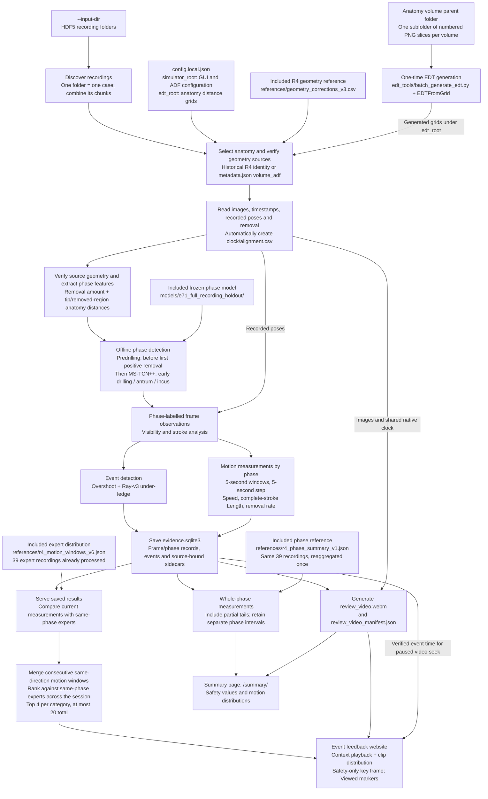

# Mastoid Feedback System

Process a completed HDF5 recording folder into video, phase detection, events
and feedback. One subfolder is one recording; its HDF5 files are chunks of that
recording. The existing website is used without per-recording configuration.

## Install

Use Python 3.12 on Windows or Linux (x86-64). From the project root:

```text
pip install -r requirements.txt
```

All processing, including phase inference, uses the same Python environment.
The requirements include CPU PyTorch; CUDA is not required. Local environments
such as `.venv/` are ignored by Git and are not part of the repository.

Before pushing code changes, also install the development tools and run both
GitHub checks (on Windows, macOS or Linux):

```text
python -m pip install --editable ".[pipeline,vision,dev]"
python -m ruff check src tests
python -m pytest -q
```

These checks use generated fixtures; the full HDF5 runtime installation above
also includes PyTorch for phase inference.

## Configure once

The only file you edit for machine paths is **`config.local.json` in this project
root**. Copy `config.example.json` if it does not exist.

| Setting | Value |
| --- | --- |
| `simulator_root` | Anatomy resource root containing `scripts/study_gui/gui_setup.yaml` and its matching `ADF/` files. Supplies specimen identity, orientation, dimensions and units; no running simulator is needed. |
| `edt_root` | Parent directory of the `edt_grids_<specimen>_256/` folders; may differ from `simulator_root` |
| `correction_table` | Included: `references/geometry_corrections_v3.csv`. Keep this relative path and the original CSV bytes. |
| `phase_model_bundle` | Included: `models/e71_full_recording_holdout/` (0.92 MB total). Keep this relative path; the frozen offline MS-TCN++ is ready for inference. |
| `video_fps` | Output video frame rate, default 10; does not change native timestamps or signal sampling |
| `motion_reference` | Saved expert distribution: `references/r4_motion_windows_v6.json`, included with the project. Keep this relative path when migrating; `null` disables expert motion comparisons. |
| `phase_summary_reference` | Included whole-phase distribution: `references/r4_phase_summary_v1.json` (0.43 MB). Keep this relative path when migrating; `null` disables the Summary page's expert comparisons. |

For a new batch, change `--input-dir`; alignment and per-recording configuration
are generated automatically. New recordings with `volume_adf` in `metadata.json`
select their anatomy model and EDT automatically. If an unknown recording lacks
this information, supply its actual specimen with `--anatomy-model RT138`, for example.
See [input format changes](docs/hdf5-directory-input.md#simulator-format-changes)
for supported fields and the shared reader to update if the simulator format changes.

Only `simulator_root` and `edt_root` normally need changing when moving machines.
The HDF5 input location is supplied separately with `--input-dir`.
Relative paths are resolved from this project root. EDTs can be stored separately
from the anatomy configuration. Model/grid identity, geometry and content hashes
remain checked after moving them. The correction CSV is copied unchanged; do not
edit or re-save it. No manual phase labels or original video are required.

No Python executable path is needed in the configuration.

The model bundle, correction CSV and saved expert reference are included with the
project in Git-visible `models/` and `references/` directories. The model bundle
contains `model.pt` (weights), `neural_preprocessing.json` (frozen input transforms)
and `manifest.json` (feature definitions and integrity hashes). No separate model
download or training is needed. Anatomy/EDT resources and `config.local.json`
remain machine-specific. Rebuild results on the new machine; old results contain
absolute source paths and remain archives.

The correction CSV is the fixed R4 geometry reference, not a phase model or a
per-recording form to fill in. It records historical specimen identities,
rotations, unit scales and review status. The current pipeline also uses it to
check supported anatomy parameters for new recordings. New recordings use their
selected model's current ADF rotation; another recording's fitted rotation is
never transferred. Keep the included CSV unchanged: its exact hash is checked.
Git attributes preserve the frozen resources' bytes on Windows and Linux.

## Generate anatomy EDT grids

You can also use pre processed EDT grid on: https://livejohnshopkins-my.sharepoint.com/:f:/r/personal/xzou8_jh_edu/Documents/skill_assessment_data/SDF_based_assistance?d=w93bcda23ec904a46a09a468be4439114&csf=1&web=1&e=f2hU25. Please download all the EDT folders.

The anatomy models' EDT grids can be generated with the included
[`edt_tools/batch_generate_edt.py`](edt_tools/batch_generate_edt.py) script.
Its input is the **folder containing the anatomy volumes**: each immediate
subfolder contains one volume's numbered, anatomy-color PNG slices.

```text
python edt_tools/batch_generate_edt.py --volumes "./volumes" --output "./data/edt" --exe "/path/to/EDTFromGrid"
```

- `--volumes`: the parent folder containing all volume subfolders.
- `--output`: the parent folder for generated EDTs; set `edt_root` to this location.
- `--exe`: an existing compiled `EDTFromGrid` executable for your operating system
  (`EDTFromGrid.exe` on Windows). It is separate from the Python dependencies.

The script generates 16 anatomy `.edt` files per volume and preserves each input
subfolder's name: `<output>/<volume-subfolder>/`. For use in this pipeline, the
generated folder names must match `gui_setup.yaml`'s `sdf_path`, for example
`edt_grids_LT151_256`. The script does not add that prefix or rename folders.
Keep input and output folders separate and non-nested. Existing `.edt` files are
skipped, so use a new output folder when regenerating grids.

This is a one-time resource preparation step, separate from processing recordings.
The HDF5 pipeline still checks the generated grids' identity, geometry and hashes
against the fixed R4 EDT catalog.

## Run

From the project root on Windows or Linux, replace the input directory:

```text
python run.py process-hdf5 --input-dir ./recordings --serve
```

The default `--anatomy-model auto` selects known R4 identities from the trusted
correction table, or new recordings from `metadata.json`'s `volume_adf` basename.
If neither identifies a specimen, provide `--anatomy-model LT151` (for example).
An explicit model conflicting with recorded metadata is rejected. The phase network
always remains the installed frozen offline MS-TCN++ model.

The command creates a new folder under `results/hdf5_batches/`, generates IDs,
alignment, configuration, video and feedback, then prints the website address
(default local port 8810 onward). Existing inputs/results are not overwritten.
`--prepare-only` validates inputs without inference/video. `--base-port` chooses another
starting port if one is occupied.

To reopen completed feedback without rebuilding:

```text
python run.py serve-batch --manifest <batch-directory>/recommendations_manifest.json
```

Select **Summary** on the feedback page, or append `/summary/` to the same server
address. Both views use the same recording and video; no new processing command
is needed. Restart an already running server after updating the application.

In the **Study ID** entry (`expert-study` mode), **Show first** selects
**Event-based** or **Summary**. New Study IDs follow this sequence:

**Background questionnaire → Analysis ready → Overall performance (before feedback)
→ First view → First-view questionnaire
→ Second view → Second-view questionnaire → Preference → Complete.**

The background questionnaire is collected once per Study ID in that participant's
file. The current resident protocol disables the three self-assessments
(`SELF_ASSESSMENTS = False`); their versioned forms remain available in code.
The two view questionnaires each ask Clarity, Actionability, New insight and
Overall performance. Preference is collected after the final configured recording;
earlier recordings continue to the next case after their second-view questionnaire.
There are no free-switching tabs during the study. The selected view order is
preserved across refresh and cases; it is selected at entry, not randomized by
the application. Study teams can assign balanced orders outside the application.

All questions are in English. The current `mastoid_surveys_v5_1_clarity` background
form asks role (Resident, Fellow or Attending), training year (resident PGY 1–5,
fellow PGY 6–7, or whole years in independent practice), and prior cortical
mastoidectomies (0, 1–5, 6–10, 11–20, or >20), and one VR question:
"Before today’s session, how often had you used a VR headset?"
(Never / Occasionally / Frequently). This records subjective prior-use frequency,
not proficiency. Older Yes/No answers are not converted to a frequency.
These answers are required. Background is collected once per Study ID; an existing
background record is preserved without inventing a missing VR response.

Before the first feedback view of **each new recording**, ask:
"Based on your own impression, how would you rate your overall performance in the recorded procedure?"
Use 1 Very poor, 2 Poor, 3 Fair, 4 Good or 5 Very good.
A rating is required; there is no Unable to judge option.
After each feedback format, explicitly ask for the participant's current rating
after reviewing that feedback (wording below), using the same choices without
prefilling the previous rating. This baseline is separate from the participant's shared
background and does not restore the six-item OSATS-like questionnaire.

Each post-feedback questionnaire contains:

| Item | Wording | Responses |
| --- | --- | --- |
| Clarity | The feedback was easy to understand. | 0 Strongly disagree to 4 Strongly agree |
| Actionability | The feedback helped me identify specific actions I could take to improve my performance. | 0–4 agreement |
| New insight | To what extent did this feedback help you recognize aspects of your performance that you had not noticed before? | 0 Not at all, 1 A little, 2 Somewhat, 3 Quite a bit, 4 A great deal |
| Overall performance | After reviewing this feedback, how would you now rate your overall performance in the recorded procedure? | Required 1–5 rating based on your own impression |

New insight measures perceived new recognition. Zero means no new insight; it
does not imply poor feedback or poor performance. Clarity and Actionability retain
their agreement scales. Overall retains all five short verbal labels and requires
an integer from 1 to 5 at all three time points. The rating cards and question
spacing are compact; all labels remain visible, including on narrow screens. These
are exploratory participant reports; no combined score is calculated. A change
in self-rating does not establish improved skill or more accurate self-assessment.
Existing sessions continue with their saved instrument and sequence; upgrading
the application does not insert questions into an ongoing or completed session.
Use a new preview Study ID to see the new instrument without changing old answers.
During simulator processing, intake collects background only; the per-recording
baseline appears after analysis is ready and before either feedback view.

The disabled, historical OSATS-like self-assessment contains six items: protection of critical
structures, visibility during drilling, drill control, purposeful bone removal,
anatomical orientation, and procedure flow and planning. Each uses 1–5 with
item-specific descriptions at 1, 3 and 5, plus separate Cannot assess and Not
applicable choices. It is an unvalidated research questionnaire; no total,
competence threshold or automatic OSATS score is calculated. The same questions
are repeated with blank responses for each round; earlier submitted ratings are
not shown. Self-assessment uses the original recording without coaching overlays.
Clarity and Actionability use 0 (Strongly disagree) through 4 (Strongly agree).
Preference is Event-based, Summary, A combination of both, or No preference.

Submitted responses, timestamps, view order and the instrument snapshot are saved
in **one JSON file per Study ID**, separately from the evidence database. Use
`--study-state study_data/participants` when starting the study server, or set
each study manifest case's `study_state` to that same directory:

```text
study_data/
  participants/
    S001.json
    test03.json
    test04.json
```

Each file contains only that participant's background, all recording-specific
responses/progress, interaction events and historical records. The existing JSON
fields are retained: background is under
`expert_study.participants[Study ID].background`, and case responses are under
`expert_study.sessions[Study ID::run ID].review_flow.responses`. Multiple recordings
for the same participant share one file; opening another case does not create
another background questionnaire. File locks and atomic replacement protect
concurrent saves. Unusual or case-conflicting IDs receive safe filenames while
retaining the original Study ID inside the file.

Current-step drafts are retained in the browser tab for refresh recovery and
removed after a successful submission. Drafts are isolated by instrument version,
Study ID, recording and step; they are not server submissions.

### Study logs: location, contents and interpretation

There are three different records: submitted questionnaires, review timing, and
interaction events. All are stored in the participant JSON, **not in the HDF5
file, video, or `evidence.sqlite3` analysis database**. The directory comes from
the server's `--study-state` argument or the selected study-manifest case's
`study_state` setting. `study_data/participants` above is a recommended location,
not a hardcoded destination. Normal filenames are `<Study ID>.json`; reserved or
case-conflicting IDs can use hashed filenames, with the original ID inside.

The local P15T4 timing preview launched on 2026-11-11 uses
`.local/previews/surveys_v4_20261111/participants/` instead. That is test/preview
storage, not a default for a new deployment. Explicitly marked preview-only QA
records must be excluded from study analysis.

In the paths below, `ID` is the participant's Study ID and `RUN` is the recording
ID. A single participant file can contain several `ID::RUN` sessions.

| Record | Location inside the participant JSON |
| --- | --- |
| Background questionnaire | `expert_study.participants[ID].background` |
| Final feedback preference | `expert_study.participants[ID].preference` |
| Post Sim Reflection, when defined by the saved instrument | `expert_study.participants[ID].closing` |
| Case-specific submitted answers | `expert_study.sessions[ID::RUN].review_flow.responses` |
| Frozen questionnaire definition and version | The same `review_flow.survey_definition` and `review_flow.survey_version` |
| Presentation order and current step | The same `review_flow.order`, `step_id`, `stage` and `cursor` |
| Forward/Back navigation history | The same `review_flow.transitions` |
| Answers withdrawn through Back | The same `review_flow.withdrawn_responses`, when present |
| Latest cumulative snapshot of each review visit | `expert_study.sessions[ID::RUN].review_timing.visits` |
| Aggregated time for each feedback order position | The same `review_timing.steps` |
| Interaction event list, including `run_id` on every row | `expert_study.events` |

Read questionnaire results from `responses`, rather than inferring answers from
click logs. Response keys identify the step, such as `baseline`, `questionnaire_0`
and `questionnaire_1`. Each response contains `answers`, `view`, `order`,
`submitted_at`, `instrument_version`, the exact `instrument` snapshot and its
`instrument_sha256`. The participant-level background/preference/closing records
are also represented in the originating session's responses; do not count the
profile copy as another submission. Earlier instruments can have fewer questions
or different response options. Missing fields are not zero or negative answers.

`review_0` / `questionnaire_0` mean the first feedback format, not necessarily
Event-based. Use the saved `view` and `order` to identify the format. The current
entry page selects the first format manually; it does not randomize the order.
Back keeps a withdrawn answer with `withdrawn_at` and `withdrawn_reason`, removes
it from active responses, and offers it for revision. Use active responses for
the accepted answer and withdrawn responses only as revision history.

#### What the interaction events mean

Every event includes `event_id`, `participant_id`, `run_id`, optional
`stimulus_id`, `event_type`, `interface_version`, `details` and `recorded_at`.
`stimulus_id` normally identifies a feedback item; it is not a participant ID.
The following are the principal events in the current sequential study:

| Event | Meaning and limitation |
| --- | --- |
| `study_started`, `study_resumed` | A case session was started or reopened. |
| `analysis_started`, `analysis_completed` | Study-service analysis/load requests and readiness; these alone are not the duration of the complete HDF5 processing pipeline. |
| `review_view_opened` | A feedback view was selected. Summary content can still be loading, so this is not the timing start boundary. |
| `review_step_advanced`, `review_step_back` | A server-accepted flow change. The authoritative step history is `review_flow.transitions`. |
| `feedback_item_opened` | An Event feedback category was selected; inspect `details.source` to distinguish automatic selection from a user click. |
| `feedback_clip_played` | A context-play request was made, with clip identity and requested video bounds. It does not prove playback succeeded or the clip was watched to the end. |
| `feedback_signal_frame_opened` | A Safety key-frame seek/pause was requested. The current presentation uses the video player, not a separately displayed source image. |
| `video_play`, `video_pause`, `video_seek` | Event-player media events with video position; optional self-assessment playback uses `details.context`. These are not a symmetric click stream for both formats. |
| `support_details_opened`, `next_case_opened` | Supporting details or the next recording were requested, when available in that interface. |

Summary phase/section coverage is stored as deduplicated keys in review timing,
not as a timestamped event for every click. Do not compare Event's `video_play`
event count against Summary as if both emit the same event list. For both formats,
use `review_timing` for playing time and coverage. Viewed means content was opened
or automatically selected; it does not establish attentive viewing or understanding.

#### Timestamps, saves and recovery

- `submitted_at`, transition `at`, withdrawn `withdrawn_at`, event `recorded_at`
  and timing `received_at` are server UTC timestamps. In particular, `recorded_at`
  is the time the server received an event, not the exact time of the browser action.
- Timing `started_at_ms` and `observed_until_ms` use browser epoch milliseconds;
  interval offsets come from the browser's monotonic clock, with discontinuity
  handling. Each interval is `[start_offset_ms, end_offset_ms, foreground, video_playing]`,
  with offsets relative to that visit's start. Aggregate duration fields ending
  in `_s` are seconds. An interval
  `[0, 5000, true, false]` represents five observed seconds in the foreground
  without video playback; it is an illustrative format example, not study data.
- `details.current_time_s` and requested clip bounds refer to the recording's
  video timeline. They are different from time spent reviewing the website.
- Questionnaire answers and flow changes are saved together under a file lock
  using atomic file replacement. The page normally advances only after success.
  Ordinary interaction events are sent separately; an event-delivery failure
  does not undo an already accepted questionnaire or transition.
- Timing saves every five seconds and at relevant boundaries. The browser keeps
  unacknowledged snapshots in a participant/recording-scoped `localStorage` outbox
  and retries them. Next waits for a timing acknowledgement before advancing.
  Each visit UUID has an increasing `sequence`; duplicate/out-of-order saves do
  not add counters. `visits` holds the latest complete snapshot for each visit,
  **not one record per heartbeat**. Closing a tab remains a best-effort final save.
- Ordinary browser interaction logging uses a best-effort request with no retry
  outbox and no visible delivery error. It may be incomplete after network errors
  or tab closure. It is not an exhaustive audit trail and must not replace timing.
- Unsubmitted questionnaire drafts stay in tab-scoped `sessionStorage`, separately
  from the timing outbox. Drafts are not accepted answers and are removed after a
  successful submission. Browser storage is not a substitute for server backups.

#### Known logging limitations in the pulled version

Code review on **2026-11-12**, at commit `27df921`, confirmed these unresolved
issues. Documenting them does not change the implementation:

1. **Back revisits are missing from aggregated review time.** The current timing
   summary caps at the first review exit, even after an allowed Back. A controlled
   test of 10 seconds initially plus 30 seconds after Back still reports 10 seconds
   foreground time. The later intervals remain in `visits`; `steps` must not be
   used as the complete review duration for those sessions until this is fixed.
   A repair must also exclude the intervening questionnaire time.
2. **Initial Event selection can be logged before Event is visible.** Rendering
   the Event component during baseline or Summary-first can mark its first moment
   Viewed and emit a play request without actual playback. It can also put Event
   keys into Summary coverage. Coverage and event counts therefore need this
   issue fixed before being interpreted as actual review behavior.

The ordinary forward-only timing definition is described below. Do not overwrite
raw logs to make affected sessions appear complete. An incomplete review, unknown
gap, uncollected metric or missing historical timing is not a zero-duration review.

#### Inspecting and backing up logs

Open the participant JSON in a text editor, or pretty-print it without modifying it:

```text
python -m json.tool study_data/participants/S001.json
```

Replace the path with the actual `--study-state` directory and participant file.
Start with `review_flow.order`, then `responses`, `transitions` and
`review_timing.steps`; inspect `visits` and `events` when checking a discrepancy.
For cross-case analysis, filter by both participant and recording, and retain
instrument/interface versions. Back up the configured participant directory;
Git does not include `study_data/` or `.local/` participant records.

Server console output or redirected `.stdout.log` / `.stderr.log` files are
operational diagnostics, not the questionnaire/timing dataset. The timing preview
uses `server-timing.stdout.log` and `server-timing.stderr.log` alongside its
`participants/` directory. These filenames are launcher choices, not universal
application log paths. Processing runtime logs are likewise separate from study
review time.

After pulling application changes, restart the Python study server and reload
the page before testing the new version. Pulling alone does not reload the running
Python code, and can leave newly served JavaScript talking to an older backend.
`/api/health` reports the configured interface label, but that label is not a
verified Git commit hash. Preserve the same `--study-state` path when restarting.

### Feedback review time

Both study formats are self-paced: there is no countdown, minimum viewing time
or time limit. Background timing starts when the assigned feedback is rendered
and its first video frame is usable, or video is explicitly unavailable. It stops
at Next; a failed submission resumes timing. Initial analysis/loading and all
questionnaires are excluded. These measurements do not change the existing
Viewed/Next rules, which record opened content rather than verified understanding.
The Back-revisit and automatic Event-selection limitations documented above apply
to the current pulled version.

Open the participant's JSON and find
`expert_study.sessions[Study ID::run ID].review_timing.steps`.
`review_0` and `review_1` identify presentation order; each includes `view`
(`event-based` or `summary`) and these fields, in seconds:

| Field | Meaning |
| --- | --- |
| `elapsed_s` | First ready display to the last observed review boundary. Includes interruptions and gaps between refreshed/reopened visits; stops at Next, before its submission wait. |
| `foreground_s` | Observed time with the review visible and the containing browser document focused. Pausing the video still allows reading time. |
| `video_playing_s` | Wall-clock playback time within foreground review. Excludes pause, seeking and buffering; playback speed does not multiply this time. It is part of `foreground_s`, not an additional duration to add. |
| `unobserved_s` | Gaps without reliable observations, including disconnected/reopened visits and long suspended callbacks. Never treated as attentive viewing. |
| `overlapping_observation_s` | Overlap between visits, useful for detecting multiple open tabs. Aggregate durations use interval unions to avoid double counting. |

`coverage` records opened Event categories/moments and shown phases/filters, or
Summary phases and opened Safety/Motion sections. It is descriptive coverage,
not proof that every item was read. `coverage_may_include_post_exit` flags late
coverage from a stale tab; its time contributions are still capped at review exit.
`visit_count` and `review_exit_at_ms` help
distinguish resumed and completed reviews. Raw cumulative visit snapshots are
in the adjacent `review_timing.visits` object, with browser timestamps and server
receipt times. Missing timing in historical sessions means **not measured**, not zero.

The browser saves every five seconds and retries pending snapshots after refresh
using a participant/recording-scoped local outbox. Next waits for a successful
timing save before advancing. Retries are idempotent. Callback gaps longer than
15 seconds, or detected clock discontinuities, receive no foreground/playback
credit; this is a measurement safeguard, not a mouse-inactivity cutoff. Laptop
sleep or an abrupt browser/device failure can leave unobserved time. Browser
tab closure is a best-effort final save: if it never returns, an unacknowledged
tail may be missing. An unfinished review has no `review_exit_at_ms`; do not
interpret its last heartbeat as a completed review or its full intended duration.
Browser storage disabled/full removes durable offline recovery, although in-memory retry
and server saves remain available. Foreground time is an exposure proxy, not eye
tracking or a measure of attention. No break button or questionnaire-duration
measurement is added. Back up the participant files with the survey responses.

To migrate an older shared JSON, first stop servers writing to it, then run:

```text
python run.py migrate-study-state --source /path/to/study_state.json --output-dir study_data/participants
```

The migration preserves the original source, imports each person's records and
copies any historical recording attachments. An exact source backup and migration
receipt are saved in the destination's `.migrations/` subdirectory. It refuses conflicting target data.
Repeating the same completed migration does not overwrite newer answers. Restart
the study server with `--study-state study_data/participants` afterwards.
For compatibility, an older `--study-state /path/to/study_state.json` argument
imports once into the sibling `study_state_participants/` directory and writes
only participant files from then on. Changes to an already imported source are
reported instead of silently replacing current answers.

`study_data/` is excluded from Git. Copy that directory separately when backing
up or moving collected responses to another computer; Git checkout alone does
not transfer survey answers. The storage directory is configured by the server
argument or study manifest, not by the anatomy/EDT configuration.

Existing IDs with the older placeholder sequence keep their original sequence
and records. They are not silently restarted or assigned retrospective baseline
ratings. Use a **new Study ID** to try the complete questionnaire sequence.

For measured processing latency and the proposed overlap with these questionnaires,
see [Processing time and planned background processing](#processing-time-and-planned-background-processing).

The Event-based study step keeps feedback on the left and video on the right.
The default **All phases** view shows the session-wide selection. Filters for
**Early Drilling**, **Antrum**, and **Incus** show only selected moments from that
phase; they never refill the list or change ranks. Expand a category:
**Safety** contains Critical Structure Violation and Poor Drill Visibility;
**Drilling motion** contains Tool speed, Stroke length, and Removal rate.
Each category contains at most four ranked moments across the entire session:
at most 20 overall, with no phase quotas and no filling of unused slots. Each
moment identifies its phase. An empty filtered list means no moment from that
phase is included in this selection, not that the phase has no issues. These
selected moments do not provide a complete assessment of each phase.
The moment rows stay on one line; expanding a category shows all its selected
rows (at most four), without an internal scrollbar. No additional
coaching-moment entry form or audio recording controls are added.

Clicking a moment row plays its interval with up to five seconds
before and after it. A small **Key frame** button below the video on the right is
available only for Safety with video and a verified anchor. It seeks the video
to that time and pauses; the normal video Play control resumes playback. There
is no separate frame image or Return to video control. Motion selection shows a
compact expert distribution with a marker for the selected clip and axis units,
without a numeric label above the marker. The legend includes **Middle half of
experts** for the weighted same-phase Q25-Q75 band. A short sentence describes
whether this clip's value is below or above typical expert values for this phase;
it does not prescribe an ideal value. Extra playback context is not included in
the measurement. The plot uses
same-phase expert windows, while the Summary page continues to use whole-phase
averages. Safety shows the observed measurement without an expert distribution:
for example, **Up to 0.21 mm deep** for a critical-structure violation.
When consecutive motion windows have been merged, the player also identifies
the longer episode from which the representative five-second window was selected.

An explicitly opened moment is marked **Viewed**; this means opened, not watched
to completion. A category is marked Viewed after all its selected moments have
been opened. In study mode, Next appears below the right-hand video card after all
selected moments across all phases have been opened; empty categories do not
block progress. On narrow screens it appears below the review. The separate
dot timeline is removed; expert dots inside the comparison chart remain.
Review marks are
local to the page and reset on reload, as in the existing resident study.
Questionnaire answers and saved study progression retain their existing storage.

Generated video, phase and events use native HDF5 elapsed time, so their seconds
can differ from older videos. Both legacy `data/*` and v3 `vision_data/*` /
`physics_data/*` layouts are supported. V3 camera poses are aligned by timestamp
over all chunks; unsupported gaps remain missing, not invented. An incompatible
file is reported. New-recording model selection does not constitute individual
geometry or clinical validation. No model training or remote inference is used.

## Maintained code

- `src/evidence_system/`: HDF5 processing, geometry, frozen phase inference, Ray
  events, storage and service.
- `apps/`: event-based recommendations, whole-phase summary and expert-study pages.
- `run.py`: the shared Windows/Linux entry.
- `config/rules/`: internal rules/source metadata; not machine-path settings.
- `models/`: the frozen three-file offline phase inference bundle.
- `references/`: the fixed R4 geometry table and saved expert distributions.
- `tests/`: source, clock, model, pipeline and service checks.

Detailed contracts: [directory input](docs/hdf5-directory-input.md),
[phase integration](docs/signal-phase-integration.md),
[data boundary](docs/data-boundary.md).

## Saved expert reference

**The 39 expert recordings have already been processed into a saved reference:**
[`references/r4_motion_windows_v6.json`](references/r4_motion_windows_v6.json).
It is included with the project and is not ignored by Git. Both root configurations
select this file. Migration needs this JSON; it does not require expert videos,
expert HDF5 files, the original R4 catalog, or regeneration of expert statistics.
The JSON contains the reference measurements and provenance; the application only
performs the small weighted comparisons when reviewing a new case.

The reference uses five participants (P4, P5, P7, P8 and P9), selected by recorded
training years >= 11, and 39 R4 recordings with complete manual phase annotations.
P9T1 is excluded because its phase boundaries are incomplete. Measurements come
from hash-verified R4 signal tables and their phase alignment. No expert feedback
text is an input. Existing geometry review flags remain unchanged.

The current reference contains **1,216 non-overlapping windows**, including 867
speed/removal-qualified windows and 544 Length-qualified windows. There are 3,369
eligible complete strokes in its saved stroke tables. Reference phases are manual;
new-recording phases are predicted by the frozen offline MS-TCN++. Predrilling is
before the first positive removal; comparisons use early drilling, antrum and incus,
with post-incus included in incus. Specimens and assistance conditions are pooled.

Each phase is compared separately. Participants receive equal weight, then their
eligible recordings receive equal weight, then windows within a recording receive
equal weight. A known participant's own recordings are excluded before weighting.
At least three eligible reference participants are required for a comparison.

## Whole-phase Summary page

`/summary/` places the existing video player beside **Safety / Exposure** and
compact **Motion** rows. Select Early Drilling, Antrum or Incus. **Go to start**
pauses the video at that phase interval; repeated intervals remain separate in
the video controls and are combined only for the phase's measurements.

[`references/r4_phase_summary_v1.json`](references/r4_phase_summary_v1.json) is
already generated from the **same 39 recordings / five experts**, by re-reading
their hash-verified original R4 signals and manual phase alignment. It contains
117 recording-phase summaries, not averages of the five-second windows. Eligible
phase totals are 86 for speed/removal, 76 for Length and 77 for frequency.
The saved JSON travels with the project; reviewing a new case never reads expert
CSV/HDF5 files or regenerates the reference. Reference phases are manual and case
phases are model predictions; anatomy/assistance conditions remain pooled.

| Summary metric | Calculation for the selected whole phase |
| --- | --- |
| Tool speed (mm/s) | Total valid adjacent path / total valid observed time |
| Stroke length (mm) | Mean full path of eligible completed strokes in the phase |
| Removal rate (mm3/s) | Supported removed volume / full observed phase duration |
| Critical Structure Violation | Distinct canonical events with a safety-qualified segment in the phase; details show each structure and maximum supported boundary intrusion |
| Drill Visibility (s) | Union of qualified visibility detections, clipped to the phase and mapped to native elapsed seconds; an estimated poor-visibility duration |

Each contiguous phase spans its first through last observed row. Repeated spans
are summed without bridging intervening phases. The final partial interval is
included even if shorter than five seconds. Speed does not bridge gaps over
0.25 seconds. Removal and endpoint counts use `(start, end]`; first-row removal
has no within-phase predecessor and is recorded as excluded, as is removal on
unsupported long gaps. At least 80% valid coverage is required; the existing
stroke completeness and invalid-segmentation exclusions also apply. Missing or
ineligible values display **Unavailable**, not zero. The Summary displays only
Stroke length, Tool speed and Removal rate under Drilling motion. Stroke frequency
is retained in the saved reference and analysis output but is not displayed or
used as a coaching trigger; the reference files do not need regeneration.

Each grey dot is one eligible expert recording. Experts are weighted equally,
then their recordings equally; a known participant's own recordings are excluded.
The band and median use those weights and require at least three experts. Expert
dots outside `Q1 - 1.5 * IQR` through `Q3 + 1.5 * IQR` are hidden only from drawing;
all values remain in the statistics. The current recording always retains its
number and marker (an edge arrow if outside the plotted scale). There is no
percentile score column or new coaching rule.

Safety measurements retain the current event thresholds. Qualified event counts
can differ from raw zero-crossing event counts. Max. intrusion uses actual
phase-local removed-point distances inside the named structure. Visibility sums
first-to-last supporting spans, which can contain gaps; it is not a continuous
occlusion measurement. **Expert safety distributions are unavailable:** the saved
expert CSVs lack the per-structure voxel counts needed to reproduce the current
safety gate and do not contain the current visibility detector's results. Legacy
overshoot/visibility values are not substituted. The page shows current-case
values and explains the missing expert comparison in the expanded details.

Implementation: [phase_summary.py](src/evidence_system/phase_summary.py) measures
signals and loads the frozen reference; [phase_summary_safety.py](src/evidence_system/phase_summary_safety.py)
aggregates existing detections; [web.py](src/evidence_system/web.py) exposes
`GET /api/phase-summary` after the existing source/clock checks. The page reuses
the event view's video layout and `/api/media/video`. The existing event coaching
rules and original results are unchanged. In study mode, the same Summary page
is embedded at its assigned review step; its API requires a started Study ID session
and completed automatic analysis. The reviewer ID never replaces the recorded
performer ID used for expert self-exclusion. The study's questionnaires are separate
from the recommendation-only pages and never become model inputs. Saved placeholder
continuations (`answers: null`), earlier reflection answers and historical completion
timestamps remain preserved. New `sequential_review_v2` progress records each survey
submission with its definition and version. The old reflection endpoint cannot
complete or overwrite a sequential session. `POST /api/expert-study/review-next`
validates the expected step ID, view, stage and answers before advancing, so an
invalid, repeated or stale request cannot skip a step or replace a submission.

Question wording, rating descriptions and server validation live in
[`study_surveys.py`](src/evidence_system/study_surveys.py). The study form rendering
is in [`surveys.js`](apps/expert_study/surveys.js), with scoped presentation in
[`surveys.css`](apps/expert_study/surveys.css). When changing an instrument, use a
new version; do not relabel historical responses. The three self-assessments
measure changes in self-evaluation, not demonstrated improvements in surgical
skill. The second feedback exposure also includes knowledge gained from the first.

Optional maintainer-only regeneration, requiring the original sources named in
the saved cohort reference, with a new output filename:

```text
python run.py build-phase-reference --motion-reference references/r4_motion_windows_v6.json --output references/r4_phase_summary_new.json
```

Normal installation and migration do not run this command.

## Window timing and coaching rules

**One valid five-second window can trigger coaching. There is no three-window
persistence requirement.** Windows have a five-second duration and five-second
step: 0-5, 5-10, 10-15 seconds relative to the start of each contiguous phase.
They do not overlap or cross phase boundaries; a final partial window shorter
than five seconds is omitted. Expert and current-recording windows use the same
protocol and native simulator time.

Motion windows require at least 80% valid coverage. Adjacent pose samples more than
0.25 seconds apart are not bridged. Missing evidence is not treated as zero motion.
Unusable display-clock mappings also suppress motion review clips. These criteria
identify descriptive review candidates; they are not clinically validated error
thresholds or skill scores.

| Coaching or metric | Current trigger / behavior |
| --- | --- |
| **Stroke length** | A valid window's mean complete-stroke length is below same-phase expert Q25 or above Q75, beyond numeric tie tolerance. At least one eligible completed stroke is required. Frequency is not part of this rule. |
| **Tool speed** | A valid window's speed is below same-phase expert Q25 or above Q75, beyond numeric tie tolerance. Suppress windows with at least 20% microscope/clutch activity. There is no additional 25% difference-from-median threshold for Event selection. |
| **Safety-boundary / overshoot** | Within one structure and one frame: at least 10 removed voxels have EDT <= 0 and the minimum EDT is <= -0.1 mm, **or** minimum EDT is < -1.0 mm. No minimum duration applies. The weaker raw signal (any removed voxel with EDT <= 0) alone does not necessarily produce coaching. |
| **Under-ledge / working-corridor exposure (Ray-v3)** | Episode span >= 0.3 s, at least 5 positive frames, mean blocked-contact ray fraction >= 70%, median registered contact count >= 20, and recording-level registered/raw contact-frame fraction >= 80%. Usable contacts and verified source binding are required. |
| **Removal rate** | A valid window's removal rate is below same-phase expert Q25 or above Q75, beyond numeric tie tolerance. This is descriptive review selection, not an efficiency or safety judgment. |
| **Stroke frequency** | Both denominator definitions remain saved in the window reference; neither triggers coaching. It is not displayed in Summary. |

Ray-v3 marks a candidate frame when at least 50% of its sampled camera-to-contact
rays are blocked. It samples at most 20 rays per frame after burr-radius + 1 mm
contact registration and initial-bone checks. Candidate frames separated by at
most one second form an episode, requiring at least two supporting frames before
the stricter coaching gates above. The blocked fraction measures rays, not image
pixels. Episode span is first-to-last supporting frame, not proof of continuous
occlusion. Unavailable/mismatched source geometry suppresses Ray coaching instead
of substituting the earlier image-edge heuristic.

Raw overshoot events group the same anatomy/phase at gaps up to 10 seconds;
safety-qualified frames form review segments at gaps up to one second. Ray review
clips can combine qualified episodes separated by up to five seconds. These are
event grouping gaps, not overlapping motion windows.

All three Motion metrics use the same strict Q25/Q75 eligibility rule. The saved
reference's older speed-tail and relative-deficit settings remain available to
legacy coaching consumers; they do not add another gate to this Event selection.
The expert reference bytes and measurement protocol are unchanged.

For the Event view, adjacent qualifying windows in the same contiguous phase
interval and direction form an episode. Gaps, ineligible windows, direction
changes and phase boundaries break episodes. Keep the single window with the
largest **absolute difference from its same-phase expert median divided by that
phase's expert IQR (Q75 minus Q25)**, then rank representatives across all phases
and retain at most four per metric. High and low values compete in the same list;
values from different metrics are never ranked against one another. The scale
makes comparisons across phases relative to each phase's expert variability.
For a numerically degenerate IQR, use the same-phase 90th-minus-10th percentile
spread, full reference range, then absolute median, in that order. An all-zero
constant reference has no relative scale: nonzero departures precede finite
scores and tie-break by absolute departure; the exported score is null, never
Infinity. Each clip records its actual scale/method. These are descriptive
ranking conventions, not calibrated probabilities or clinical severity scores.
A single qualifying window is sufficient. The selected measurement remains five
seconds, even when the surrounding episode or playback context is longer.

Safety retains the existing qualification rules above. Rank Critical Structure
Violation by maximum supported intrusion and Poor Drill Visibility by detected
episode duration, with at most four per category across the session. Safety has no matched expert
reference, so its ranking is not described as expert deviation. The original
canonical events and legacy coaching payload remain available; the additional
`event_review` payload selects what the ranked Event interface displays.

Ranked selection lives in [event_review.py](src/evidence_system/event_review.py).
Underlying measurement and rule definitions live in [motion_comparison.py](src/evidence_system/motion_comparison.py),
[under_ledge_ray.py](src/evidence_system/under_ledge_ray.py),
[edt_enrichment.py](src/evidence_system/frame_pipeline/edt_enrichment.py),
[events/builder.py](src/evidence_system/events/builder.py) and
[coaching_plan.py](src/evidence_system/coaching_plan.py).

## Metric definitions

- **Speed (mm/s):** valid observed path length / valid native observation time.
- **Removal rate (mm3/s):** qualifying frame-assigned removed volume / full five
  seconds; counts with unsupported predecessor intervals are omitted.
- **Length (mm):** full path length within each recorded stroke ID. Assign the
  whole stroke by its endpoint in `(window start, window end]`; never shorten its
  path at the window boundary. `mean_stroke_length_mm` averages eligible strokes
  ending in that window. No eligible endpoints produces `null`, not zero.
- **`stroke_frequency_hz`:** recorded stroke endpoints in `(start, end]` / full
  five seconds. **`stroke_rate_per_s`:** distinct recorded drilling stroke IDs
  in `[start, end]` / `stroke_drilling_time_s`. The latter sums in-window observed
  intervals whose right-hand frame is marked drilling, with each interval capped
  at one second. This adapts the earlier drilling-mask formula to native time;
  it is not measured motor-on time. Zero denominator produces `null`. A stroke
  crossing a window boundary may count in both ID-based numerators.

Length excludes strokes with fewer than two points, missing or forced terminal
boundaries, interleaved IDs, phase changes, selected-frame gaps over 0.25 seconds,
or invalid source segmentation. Raw paths and reasons remain in `stroke_lengths`.
P4T2, P4T4 and P4T6 have nonfinite legacy turning angles: their raw source values
remain saved, but their Length/frequency eligibility is false. The existing stroke
segmentation algorithm is reused; this reference does not silently repair it.

Older references remain preserved for archives. Old motion sidecars are validated
on their original grid, then current observations are remeasured in memory on the
selected reference's grid; old outputs are not overwritten. Current deployment
uses v6, not the earlier overlapping references or combined antrum Length/frequency
rule. Optional maintainer-only regeneration from the verified R4 catalog:

```text
python run.py build-motion-reference --catalog /path/to/organized --output references/r4_motion_windows_new.json
```

Use a new filename and update `motion_reference` only after validation. This is not
part of normal installation, migration or processing a new recording.

## Frame review

Click a moment to **Play context** with up to five seconds on either side, clamped
to video bounds; playback pauses at the context end. The small **Key frame** button
below the video is Safety-only and seeks the existing video to the bound event
anchor, then pauses. Continue using the video's normal Play control. The page
does not load a separate source-frame image or offer a Return to video button.
The button requires playable video and a verified anchor; no key frame is
invented when source binding is unavailable.
Playback context can overlap between clips; analysis windows do not.
Source identity checks still apply. The resampled review video can omit source
frames; this control is a video-time seek, not an original-image display. Motion
moments use context playback and their measured window,
without a key-frame button.

## Processing time and planned background processing

### Measured processing time

On **2026-11-04**, one fresh-output CPU run processed the George recording
`2026-06-25_13_51_34`: six HDF5 chunks, **371 MB**, **266.05 seconds of recorded
activity**, and 2,565 native image frames. The machine used Windows 11, 32 logical
processors, Python 3.12.7 and CPU PyTorch 2.11.0. The existing frozen MS-TCN++, EDT
grids and saved expert distributions were reused.

| Processing component | Measured wall time |
| --- | ---: |
| Input preparation, alignment, geometry checks and anatomy distances | 15.38 s |
| Phase detection, including feature preparation and model-worker startup/loading | 4.49 s |
| Visibility features, stroke/motion metrics, event detection and relations | 28.24 s |
| Review video generation and validation, at 10 fps | 92.30 s |
| Final Event feedback and whole-phase Summary preparation | 1.13 s |
| Artifact/database writes, application startup and other orchestration | 6.52 s |
| **Total: HDF5 input to video and both feedback payloads ready** | **148.06 s (2 min 28 s)** |

Video accounts for approximately **62%** of the total. Subtracting that measured
step leaves **55.76 s**; this is an accounting estimate, not a separately benchmarked
no-video or concurrent implementation. The visibility/analysis row includes
25.68 s of RGB/depth supporting features and 2.30 s of Ray-based drill-visibility
detection. The phase time is not pure neural-network forward-pass latency.

This is **one local measurement**, not a cohort average or a Windows/Linux
performance guarantee. Filesystem cache was uncontrolled and the timing wrapper
adds small logging overhead. Installation, model training, EDT/reference generation,
interpreter startup before the timer, browser rendering and questionnaire time are
excluded. All stages completed, video validation and database integrity passed,
and phase inputs/probabilities matched the earlier George result exactly.
The local receipt is `.local/validation/pipeline_timing_20261104/timing_receipt.json`;
that local benchmark directory is not included in Git. The measurement above is
recorded here for migration and planning.

### Full questionnaire/processing overlap — proposed

The simulator intake currently collects shared background while processing and
waits for the full server. In v4, the single Overall performance baseline is asked
after analysis is ready. The more extensive overlap and independent readiness
conditions below remain a proposal; they are not the current baseline behavior.

**Target behavior:** participants can fill in the initial questionnaires while
processing continues in the background. Entering the first feedback view requires
**both the prerequisite questionnaires to be saved and all required results to be
ready**. A completed questionnaire must not be discarded or require resubmission
because processing is still running.

The proposed sequence is:

1. When a completed recording is assigned to a study session, start or attach to
   its background processing job immediately. Show the background questionnaire
   without waiting for the evidence database or coaching plan.
2. Once the original review video and its alignment are validated, allow the
   baseline self-assessment. Other analysis can continue during this assessment.
   Show only the recording; do not expose feedback, predicted phases or comparison
   results before the baseline is submitted.
3. Save the completed background questionnaire and baseline independently of job
   progress. If processing is unfinished, show a waiting state with its actual
   stage. If processing finished first, continue showing the unfinished survey.
4. Enable entry to the chosen first feedback view only when both conditions are
   satisfied. Keep the existing first-view/second-view order and later surveys.

Use separate readiness conditions:

| Condition | Meaning |
| --- | --- |
| `media_ready` | The finalized video and native-frame/time alignment are validated for this recording; sufficient to show the baseline recording. |
| `results_ready` | Required source/geometry checks, phase prediction, event/motion/visibility analysis, database, video/alignment, Event feedback and Summary outputs have completed and passed their applicable integrity checks for the same recording/configuration. |
| `prerequisites_complete` | The participant's background questionnaire and this case's baseline self-assessment are saved. |
| Feedback entry allowed | `results_ready AND prerequisites_complete`, enforced by the server as well as the interface. |

Readiness is an execution/integrity condition, not a declaration of clinical
validity. A valid zero-event result is ready; an unfinished or failed required
detector is not. Preserve existing legitimate unavailable/missing metric values
and their reasons rather than requiring every phase to have a numeric score.
Preparing results early must not reveal them through study feedback APIs or a
direct Summary link before the prerequisite surveys are complete.

The current implementation does **not** run this background workflow:
`process-hdf5 --serve` finishes the build before starting the feedback server.
The study's **Start automatic session analysis** action retrieves and assembles
already processed evidence; its progress animation is not an HDF5 job monitor.
The existing serial study sequence documented above remains the implemented one.

### Implementation approach to evaluate

| Area | Proposed change |
| --- | --- |
| `cli.py` and `directory_pipeline.py` | Start a lightweight study entry service before processing finishes; run the existing HDF5 build in a separate worker process. Publish persisted job stages and final readiness. |
| `web.py` | Allow study/survey initialization without a completed database. Load the result-backed feedback service only when ready; provide job status and media metadata independently of feedback. Separate questionnaire progression from processing completion, and enforce the feedback-entry gate. |
| `apps/expert_study/app.js` | Keep forms usable while polling real job status. Save answers immediately, restore progress after refresh, and show a waiting state only when the participant reaches an unmet readiness condition. |
| Video preparation | Initially overlap processing with the background questionnaire. For earlier baseline access, move video production earlier or encode it during recording in a separate background process, retaining the native time/frame mapping. |

Persist one job per recording and processing configuration, associated with the
study case. Reopening a tab or submitting a survey must reuse that job rather than
launch duplicate builds. A browser disconnect must not cancel processing. Failed
or interrupted jobs retain survey answers and report a recoverable status; only
validated, completed outputs may be published as ready. Preserve existing saved
sessions and the current ability to open prebuilt recordings.

If encoding during recording is tested, keep encoding off the simulator's main
loop. An alternative is to process HDF5 chunks only after the recorder explicitly
closes them. Preserve the original timestamps, cross-chunk frame mapping, source
gaps and final frame. Offline MS-TCN++ still runs on the completed signal sequence.
If most video work finishes during recording, the measured 55.76 s of other work
provides an initial estimate of post-recording computation, plus remaining video
work and validation; it is not a promised wait time. Survey overlap reduces the
participant's exposed waiting time, not the amount of computation performed.

### Tests required before enabling this workflow

- **Both completion orders:** processing finishes before surveys, or surveys finish
  before processing. Neither path skips the baseline or reveals partial feedback;
  submitted answers remain saved while waiting. Test both feedback-view orders.
- **Media and baseline:** a late video delays only video-dependent self-assessment;
  no predicted phase/coaching content is delivered before baseline completion.
- **Server readiness:** direct links/API requests, failed stages and incomplete
  files cannot bypass the gate. Valid zero-event and legitimately unavailable
  metrics retain their existing meaning.
- **Recovery and identity:** refresh, browser disconnect, duplicate tabs, job retry
  and server restart preserve answers/order, avoid duplicate jobs, and never attach
  another recording's or an outdated configuration's results. Legacy/prebuilt
  sessions continue to work.
- **Timing and recording quality:** measure simulator frame rate, dropped frames,
  encoding backlog and CPU/disk contention during recording. Validate source-to-
  video alignment, native key frames, cross-chunk boundaries, gaps and the final frame.
- **Result equivalence and latency:** compare phase inputs/probabilities, events,
  motion metrics and feedback against the serial pipeline on the same input.
  Benchmark repeated short/long recordings and target Windows/Linux machines.
  Record processing start/ready, video-ready, prerequisite-survey completion and
  feedback-entry times separately. Residual wait after the prerequisites are saved
  is `max(0, results_ready_time - prerequisites_completed_time)`; also report any
  earlier wait for the baseline video.

## Current pipeline

Start with `python run.py process-hdf5 --input-dir ./recordings --serve`.
The batch discovers every recording directory; all HDF5 chunks in one directory
belong to that recording. The diagram shows data dependencies for each recording,
not parallel execution. The build saves the evidence database before generating
the review video; the service then compares measurements and assembles feedback.



Phase detection consumes removal/anatomy signals; video appearance and motion
metrics are not phase-model inputs. Video and feedback share the generated native
time alignment. New-recording geometry retains its explicit verification status;
using the R4 model resources does not certify a new recording's calibration.

The expert JSON is loaded directly when serving feedback; the 39 expert recordings
are not reprocessed. Speed, Length and removal rate use the same-phase window
distribution for ranked Event review; one valid qualifying window is sufficient.
Summary displays the same three Motion metrics, aggregated over each phase. The trigger
details are listed above. The Summary reference is loaded separately and does not
change the event view's five-second coaching rules.

Each case is saved under `results/hdf5_batches/<batch>/<recording>/`, with its
generated configuration, clock, analysis stages, database and video. The batch's
`recommendations_manifest.json` can reopen completed results with `serve-batch`.
